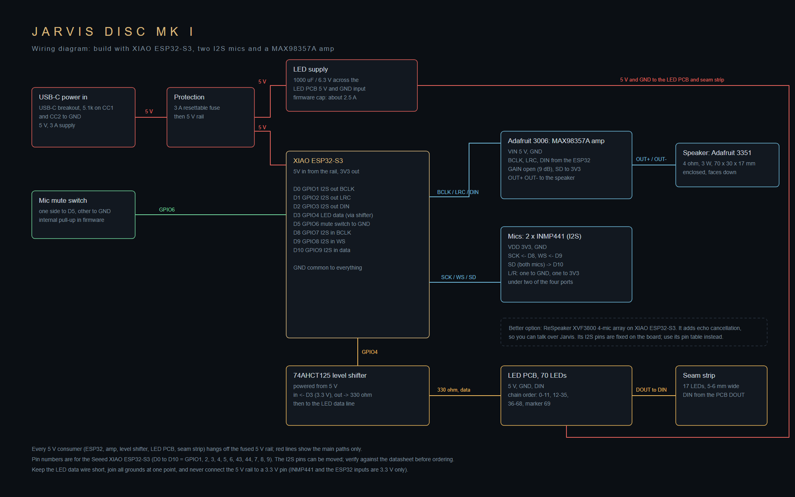

# Jarvis Disc — Wiring Diagram

## What this is

The electrical hookup diagram for the **Jarvis Disc Mk I**, built around off-the-shelf
modules:

- `jarvis-disc-wiring.svg` — editable 2000×1250 master diagram
- `jarvis-disc-wiring.png` — raster render of the same

It shows the exact pin-level connections between:

- **Seeed XIAO ESP32-S3** — controller: Wi-Fi, I2S, and LED driving
- **2× INMP441** I2S microphones — stereo capture, wired on separate I2S data lines so
  the server can later do mic-array processing (beamforming / localization)
- **MAX98357A** I2S amplifier → **4Ω speaker** — TTS and music playback
- **Addressable LED strip(s)** — the 70-LED main ring plus 17-LED seam strip
- **Physical mic-mute switch** — cuts microphone power in hardware, not in software
- **USB-C** — 5V power and configuration/flashing

## Why it exists

Jarvis is being consolidated onto a dedicated Ubuntu server that owns all intelligence:
inference, memory, orchestration, media. The disc is the standardized physical endpoint
that brings that intelligence into each room — it captures audio, streams it to the
server, plays back speech and music, and signals state with light.

For that to work at house scale, the node hardware must be trivially reproducible: same
modules, same wiring, same firmware image, disc after disc. This diagram is the contract
that makes a disc a *product* rather than a one-off breadboard. It is the build sheet a
technician (or future-you at 2am) follows to bring up DISC-002 identically to DISC-001,
and the reference the firmware's I2S and LED pin definitions are written against.

## Status

Design reference only. No firmware, CAD, or parts procurement lives here — those are
separate phases of the Jarvis project.
